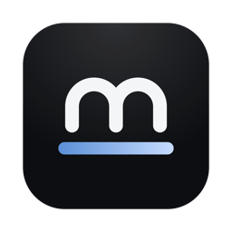
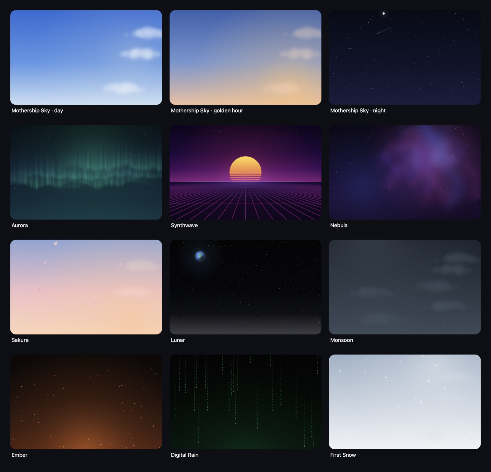

<p align="center">
  
</p>

<h1 align="center">Mothership</h1>

<p align="center">
  <strong>Mission control for your coding agents.</strong><br>
  A native macOS terminal that knows what every Claude Code, Codex, OpenCode and Gemini
  session on your Mac is doing, and tells you the moment one needs you.
</p>

<p align="center">
  <a href="https://github.com/harshpreet931/mothership/actions/workflows/ci.yml"></a>
  
  
  <a href="LICENSE"></a>
</p>

---

> **Status: early alpha.** Mothership is built quickly and in the open. Expect rough edges,
> and please [open an issue](../../issues) when you hit one.

## Why

Running several agents at once means juggling tabs, missing permission prompts, and losing
track of which agent finished what. Mothership is a terminal built around that workflow:
- every agent's state is visible at a glance;
- agents can be approved from wherever you are;
- shells survive quitting the app;
- several agents can attempt the same task in parallel, so you keep the best result.

It's built on [libghostty](https://ghostty.org) for a fast, correct terminal, with a native
AppKit and SwiftUI shell around it.

## Highlights

**Agents**
- **Every agent, one place.** Detects Claude Code, Codex, OpenCode and Gemini CLI, plus aider,
  amp, cursor-agent, copilot, goose, crush, qwen, kiro and droid. This includes sessions
  running in VS Code, iTerm or tmux.
- **Live state without setup.** Mothership shows each agent as working, needs you, done or
  error. Alongside that it shows what the agent is doing ("Running pnpm test"), model,
  branch, tokens, estimated cost and how full the context is. Updates arrive in about a
  millisecond, using kqueue on agent transcripts.
- **Answer permission prompts from anywhere.** Allow or deny from the sidebar, a macOS
  notification, the Fleet view, or `mship approve`/`mship deny`. This works through Claude
  Code and Codex hooks and an OpenCode plugin. Installing them shows the exact config change
  and backs up the config first.
- **Fleet and Home.** Fleet shows every agent's last exchange as chat bubbles. Home shows
  what needs you, what's working, today's tokens and cost, open ports, and agents running
  elsewhere.

**Tasks**
- **New Task and Best-of-N** (⌘N). One prompt goes to one or more agents, each in its own git
  worktree. You then compare their diffs, cost and final messages side by side. Keep the
  winner as a PR, a merge or a branch, and discard the rest.
- **PR status.** Checks and review state for each workspace's branch, via `gh`.

**Terminal**
- **Sessions that survive.** `mshipd` owns every shell, so quitting or even crashing
  Mothership leaves your agents running. Panes reattach with their screen and scrollback
  intact. tmux isn't required.
- **A browser that agents can drive.** A built-in browser pane has DOM snapshots,
  click/fill/eval, console capture and screenshots. An element picker sends a page element to
  your agent. All of this is exposed to agents over MCP (`mship mcp`).

**Look and feel**
- **Themes, including a living sky.** The default sky follows the real sun from dawn to
  night, with twinkling stars and drifting clouds. There are 18 more themes: Aurora,
  Synthwave, Nebula, Sakura, Monsoon, Lunar, Ember, Digital Rain and others. You can also
  [write your own](docs/themes.md) in JSON.

<p align="center">
  
</p>

## Requirements

- macOS 26 or later
- Xcode 26 with Swift 6.2 or later (developed with Xcode 26.4 and Swift 6.3)

## Build and run

```sh
git clone https://github.com/harshpreet931/mothership.git
cd mothership
scripts/bundle.sh            # builds and assembles build/Mothership.app
open build/Mothership.app
```

| Task | Command |
|---|---|
| Release build plus DMG | `scripts/release.sh` (see [docs/RELEASING.md](docs/RELEASING.md)) |
| Unit tests | `swift test` |
| End-to-end QA against a scratch instance | `scripts/qa.sh` |

## Connect your agents

Open Home (⌘0) or Settings → Agents and click **Connect** for each agent. Mothership shows
the exact change to the agent's config before writing anything, keeps a backup, and works
alongside other tools' hooks. Without hooks Mothership still tracks your sessions, but hooks
make state changes instant and let you answer permission prompts remotely.

## The `mship` CLI

Every pane has `mship` on its `PATH`:

```sh
mship split --down -- npm run dev          # a pane beside this one
mship open localhost:3000                  # this workspace's browser pane
mship new --name auth-fix --cwd ~/src/api -- claude "fix the failing auth tests"
mship status                               # every agent, everywhere
mship approve                              # allow the request an agent is waiting on
long-job && mship notify "Deploy finished"
claude mcp add mothership -- mship mcp     # give an agent Mothership's tools
```

`mship help` lists every command.

## Keyboard

| | |
|---|---|
| ⌘K | Search and commands |
| ⌘T / ⌘D / ⌘⇧D | New workspace / split right / split down |
| ⌘N | New task |
| ⌘0 | Home |
| ⌘⇧F | Fleet |
| ⌘⇧U | Jump to the agent that needs you |
| ⌘L | Message bar |
| ⌥⌘K | Clear the screen |
| ⌥⌘Q | Quit and end all sessions |

## Architecture

One Swift package with focused modules: terminal engine, agent engine, session daemon,
control plane, browser, themes, and more. Start with
[docs/ARCHITECTURE.md](docs/ARCHITECTURE.md). [CLAUDE.md](CLAUDE.md) has the module map and
house rules. Design language: [docs/DESIGN.md](docs/DESIGN.md).

## Contributing

Contributions are welcome. See [CONTRIBUTING.md](CONTRIBUTING.md). For security issues,
follow [SECURITY.md](SECURITY.md) rather than opening a public issue.

## Acknowledgements

- [Ghostty](https://ghostty.org) and [libghostty-spm](https://github.com/Lakr233/libghostty-spm):
  the terminal at the core.
- Terminal color themes from
  [iTerm2-Color-Schemes](https://github.com/mbadolato/iTerm2-Color-Schemes) (MIT), via
  libghostty-spm.

## License

[MIT](LICENSE)
